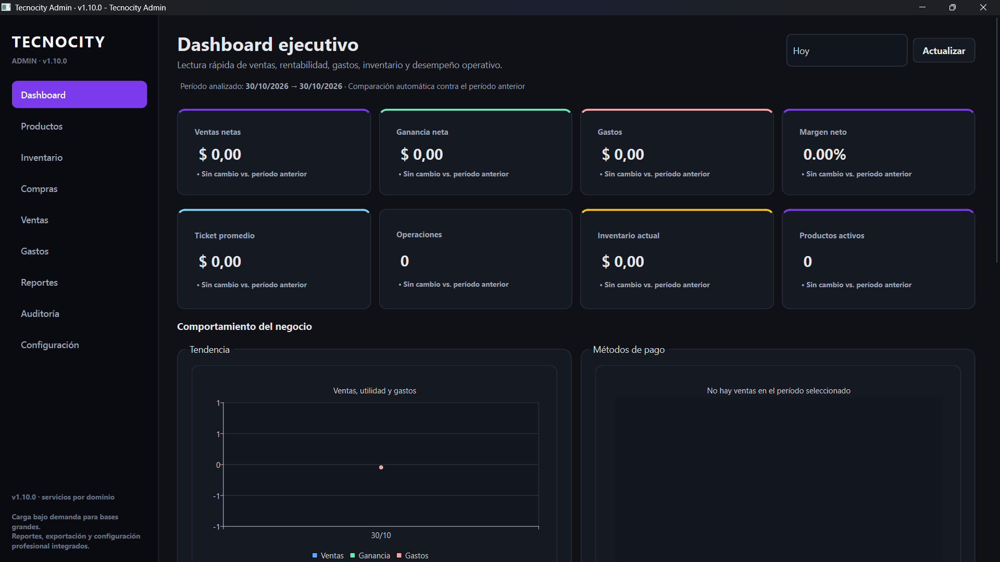
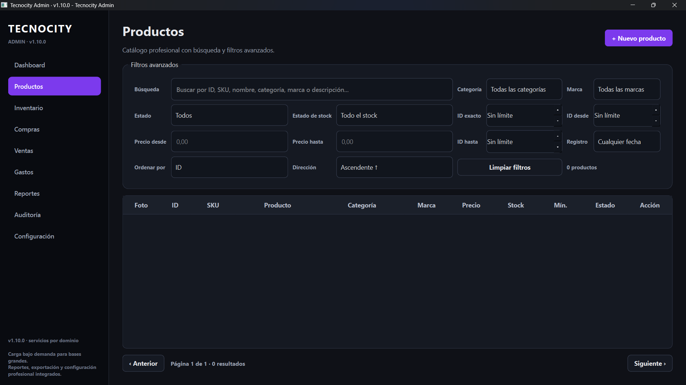
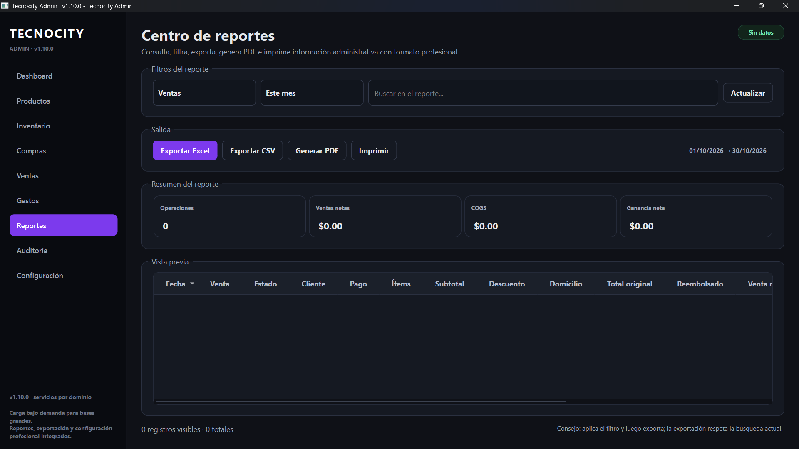
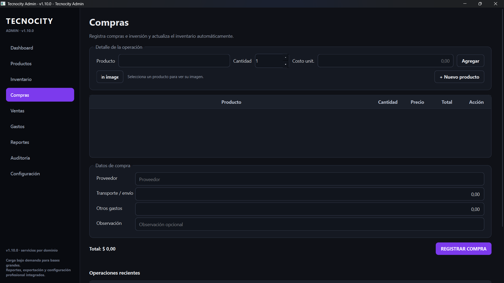
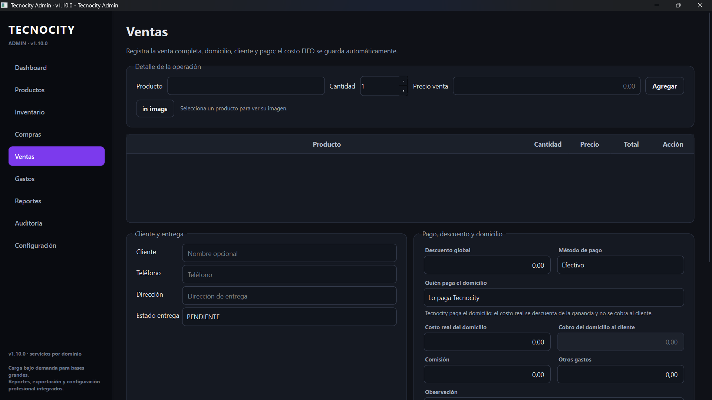

# Tecnocity Admin

**Versión:** 1.10.0  
**Tipo:** aplicación de escritorio para Windows y otros sistemas compatibles con Qt  
**Tecnologías:** Python, PySide6, SQLAlchemy y SQLite  
**Licencia:** [PolyForm Noncommercial 1.0.0](LICENSE)

Tecnocity Admin es una aplicación de escritorio para administrar las operaciones de un pequeño negocio desde una base de datos local. Esta publicación contiene el código fuente; no incluye bases de datos reales, credenciales OAuth, tokens, registros ni entornos virtuales.

> **Uso no comercial:** el código se ofrece bajo PolyForm Noncommercial 1.0.0. Se permite el uso, estudio, modificación y redistribución únicamente para fines permitidos por esa licencia. El uso comercial requiere autorización o una licencia comercial independiente del titular de los derechos. Esta licencia no es una licencia Open Source aprobada por OSI; consulta [Licencias de terceros](docs/THIRD_PARTY_LICENSES.md) antes de distribuir ejecutables.

## Capturas de pantalla

A continuación, puedes conocer la interfaz de Tecnocity Admin y sus principales módulos.

<table>
  <tr>
    <td align="center" width="50%">
      <strong>Dashboard financiero</strong><br><br>
      
    </td>
    <td align="center" width="50%">
      <strong>Productos</strong><br><br>
      
    </td>
  </tr>
  <tr>
    <td align="center" width="50%">
      <strong>Control de reportes</strong><br><br>
      
    </td>
    <td align="center" width="50%">
      <strong>Compras</strong><br><br>
      
    </td>
  </tr>
  <tr>
    <td align="center" colspan="2">
      <strong>Ventas</strong><br><br>
      
    </td>
  </tr>
</table>

## Funcionalidades

- **Dashboard financiero:** indicadores, comparaciones por período, tendencias y gráficos de ventas, ganancias, gastos, métodos de pago y productos.
- **Productos y catálogo visual:** registro, edición, filtros, ordenamiento, estado y fotografía opcional por producto.
- **Compras:** registro de compras con varios productos, proveedor, transporte y costos adicionales; creación de productos con fotografía desde el flujo de compra.
- **Inventario:** existencias, valoración FIFO, ajustes y movimientos auditables.
- **Ventas:** ventas con varios productos, descuentos, comisiones, gastos, clientes, métodos de pago y estados de entrega.
- **Devoluciones y cancelaciones:** procesos parciales o completos que conservan el historial y restituyen existencias según el costo histórico disponible.
- **Gastos y reportes:** gastos generales y asociados a ventas; reportes filtrables con exportación a Excel, CSV, PDF e impresión.
- **Respaldo:** copias locales y opción de integración con Google Drive mediante OAuth configurado por cada usuario.
- **Apariencia:** temas claro, oscuro y futurista morado.

La aplicación utiliza SQLite local. No necesita un servidor propio ni una cuenta en la nube para las funciones locales. Google Drive es opcional y requiere configurar credenciales OAuth propias.

## Requisitos

- Python **3.11, 3.12 o 3.13**. El proyecto declara `>=3.11,<3.14`.
- Windows 10/11 recomendado para el uso de escritorio.
- Conexión a Internet solo para instalar paquetes o usar la integración opcional con Google Drive.

## Instalación y ejecución desde el código fuente

En PowerShell, desde la carpeta del proyecto:

```powershell
py -3.12 -m venv .venv
.\.venv\Scripts\Activate.ps1
python -m pip install --upgrade pip
python -m pip install -r requirements.txt
python run.py
```

Si PowerShell bloquea la activación del entorno, puedes ejecutar directamente:

```powershell
.\.venv\Scripts\python.exe -m pip install -r requirements.txt
.\.venv\Scripts\python.exe run.py
```

Para instalar dependencias de desarrollo y ejecutar las pruebas:

```powershell
python -m pip install -r requirements-dev.txt
python -m pytest -q
```

Consulta [Instalación y compilación](docs/BUILD_WINDOWS.md) para generar la aplicación ejecutable.

## Datos y privacidad

- Al ejecutar desde el código fuente, la base SQLite, la configuración, los respaldos y los registros se crean en las carpetas `data/` y `logs/` del proyecto.
- En la aplicación compilada, los datos del usuario se guardan fuera de la carpeta del ejecutable, en `%LOCALAPPDATA%\Tecnocity Admin\` en Windows.
- `data/config/settings.json`, los archivos de Google OAuth y las bases de datos locales están excluidos de Git mediante `.gitignore`.
- Cada persona debe usar su propia base de datos y, si activa Google Drive, sus propias credenciales OAuth. Nunca publiques `client_secret.json`, `token.json`, bases de datos de trabajo ni respaldos.

## Estructura del repositorio

```text
TecnocityAdmin/
├── app/
│   ├── backups/       # Respaldo local y proveedor Google Drive
│   ├── config/        # Configuración y preferencias
│   ├── database/      # Motor, sesiones y migraciones
│   ├── models/        # Modelos SQLAlchemy
│   ├── reports/       # Consultas y exportadores
│   ├── repositories/  # Acceso a datos
│   ├── services/      # Reglas de negocio por dominio
│   ├── theme/         # Paletas y temas
│   ├── views/         # Ventana principal
│   └── widgets/       # Interfaz y gráficos
├── assets/            # Hoja de estilos de la aplicación
├── data/              # Datos locales (no se publican)
├── docs/
│   ├── screenshots/   # Capturas de pantalla
│   └──                # Documentación técnica
├── tests/             # Pruebas automatizadas
├── tools/             # Herramientas de desarrollo
├── run.py             # Punto de entrada
├── requirements.txt
└── pyproject.toml
```

## Documentación

- [Arquitectura](ARCHITECTURE.md)
- [Registro de cambios](CHANGELOG.md)
- [Validación y pruebas](VALIDATION.md)
- [Rendimiento](PERFORMANCE.md)
- [Instalación y compilación para Windows](docs/BUILD_WINDOWS.md)
- [Configuración de Google Drive](docs/GOOGLE_DRIVE_SETUP.md)
- [Reglas financieras de devoluciones](docs/REGLAS_FINANCIERAS_DEVOLUCIONES.md)
- [Licencias y avisos de terceros](docs/THIRD_PARTY_LICENSES.md)
- [Lista de comprobación antes de publicar](docs/PREPUBLICACION_GITHUB.md)
- [Informe de revisión del paquete](INFORME_REVISION_GITHUB.md)

## Pruebas

```powershell
python -m pytest -q
```

La suite incluye pruebas de servicios, cálculos monetarios, reglas de devoluciones, compras, ventas, inventario, migraciones, reportes, configuración y estructura de la interfaz. Algunos tests de interfaz se omiten automáticamente cuando PySide6 o un entorno gráfico no está disponible.

## Gráficos y dependencias Qt

Los gráficos del Dashboard se dibujan con `QPainter` en `app/widgets/dashboard_charts.py`. El proyecto no importa `PySide6.QtCharts` ni `PySide6.QtGraphs`; esto evita añadir el módulo Qt Charts, que se distribuye bajo condiciones de licencia distintas y fue marcado como obsoleto por Qt desde Qt 6.10. El resto de PySide6/Qt conserva sus propios avisos y obligaciones de licencia; consulta [Licencias de terceros](docs/THIRD_PARTY_LICENSES.md).

## Contribuciones

Lee [CONTRIBUTING.md](CONTRIBUTING.md) antes de enviar cambios. No incluyas datos de clientes, bases reales, credenciales, tokens, respaldos ni información privada en incidencias o solicitudes de cambios.

## Seguridad

Consulta [SECURITY.md](SECURITY.md) para reportar vulnerabilidades de forma responsable.
